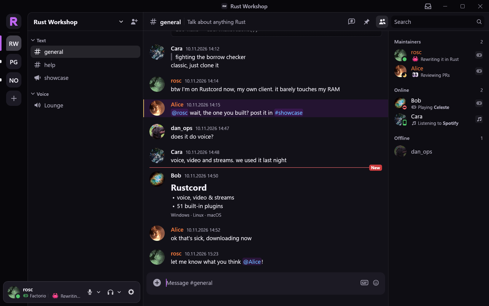
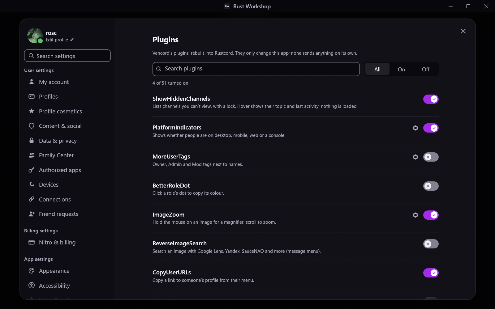
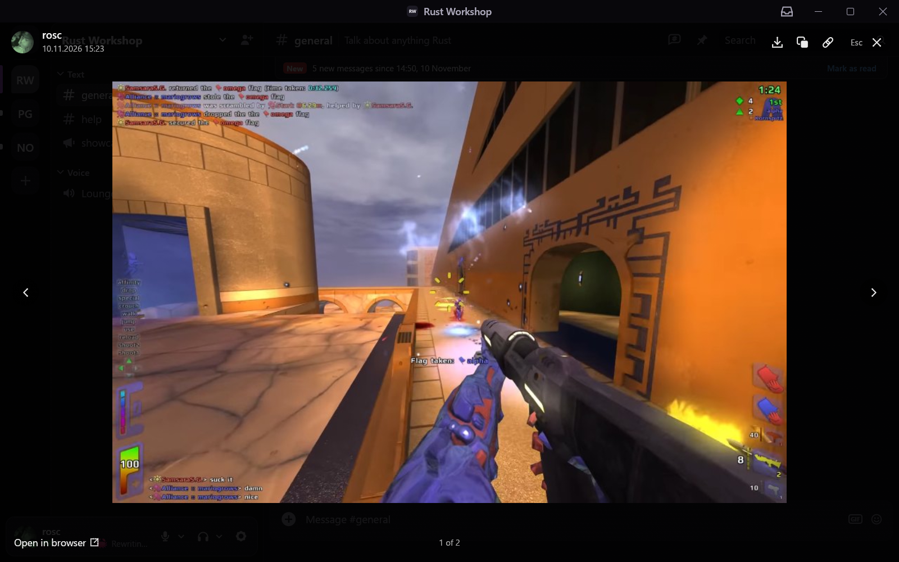
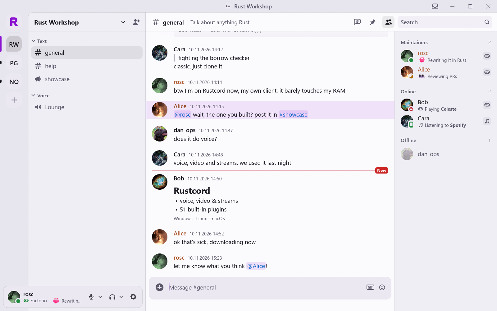

<p align="center">
  
</p>

<h1 align="center">Rustcord</h1>

<p align="center">
  A lightweight, unofficial desktop client for Discord that I built from scratch in Rust.<br>
  No Electron – egui + tokio, talking to the HTTP API and the Gateway directly.<br>
  Made by me, <a href="https://github.com/r0sc">rosc</a>.
</p>

<p align="center">
  
  
  
  
  <a href="https://github.com/r0sc/Rustcord/releases/latest"></a>
  <a href="https://github.com/r0sc/Rustcord/releases"></a>
</p>

> **Beta – expect bugs.** Rustcord is a beta and may still have bugs. I vibe-coded it: almost all
> of the code was written with AI coding tools (Claude Code), not by hand. I've only tested many
> features with offline demo data, not with a live account, and I've tested the Linux and macOS
> builds the least. If something breaks, please tell me in an
> [issue](https://github.com/r0sc/Rustcord/issues).

<p align="center">
  
</p>

<p align="center">
  
</p>

<table>
  <tr>
    <td></td>
    <td></td>
  </tr>
  <tr>
    <td align="center">My profile, with a local-only banner</td>
    <td align="center">Settings → Plugins (Vencord-style, built in)</td>
  </tr>
  <tr>
    <td></td>
    <td></td>
  </tr>
  <tr>
    <td align="center">Pictures and videos open in the app</td>
    <td align="center">Paper Light theme</td>
  </tr>
</table>

<sub>The screenshots use Rustcord's offline demo data, signed in as me (rosc). The other people,
servers and messages are made up; the live stream and the shared picture show Red Eclipse
gameplay (see <a href="#credits">Credits</a>). <code>scripts/readme-shots.py</code> takes them
again.</sub>

> **Warning.** Third-party clients that log in with a user account violate Discord's Terms of
> Service and can get the account banned. You use this at your own risk. I made Rustcord behave
> like a normal user client (no automation, nothing is sent on your behalf except your status and
> activity, like the official app, all rate limits are respected), but that doesn't remove the
> risk. Rustcord shows "Playing Rustcord" as your activity by default. Friends, and Discord, can
> see that you use a third-party client. Turn it off in Settings → Activity privacy. Rustcord is
> not affiliated with Discord.

## Why Rustcord

On November 4, 2026, Discord's co-founder and CTO Stanislav Vishnevskiy announced that Discord is
rebuilding its desktop app in Rust instead of Electron. An early internal Windows build exists and
is heading into private testing; there is no release date yet, and the Electron app carries on in
the meantime ([mlq.ai](https://mlq.ai/news/discord-is-rebuilding-its-desktop-app-in-rust-to-cut-memory-use/),
[andrealosavio.com](https://www.andrealosavio.com/en/blog/discord-rust-client-rewrite),
[tech-insider.org](https://tech-insider.org/discord-electron-rust-gpui-rebuild-290mb-ram-2026/)).

I didn't feel like waiting for it. So I vibe-coded my own Rust client and shipped it first:
Rustcord 0.1.0 came out on November 15, 2026, for Windows, Linux and macOS, while Discord's Rust
app still has no release date. I also built in plugins, the way [Vencord](https://vencord.dev)
adds them to the official app: 48 of them, re-implemented in Rust, off by default, and they only
change this app.

— rosc ([@r0sc](https://github.com/r0sc))

## Features

What's in it so far:

- Login by QR code, by email/phone + password (with 2FA), or with a pasted token; the
  session token is kept in the OS credential store, logout clears it (see [Logging in](#logging-in)).
- Gateway with heartbeat, zombie detection, resume, reconnect backoff, zlib-stream compression.
- REST rate limiting per bucket + global, honouring `retry_after`.
- Server list with icons, channel list per server, DM list, member list.
- Rustcord's own app sounds, made in code: message and mention pings, call rings, voice
  join/leave, mute, deafen, push to talk and streams; each one can be switched off, with one
  volume.
- Keyword alerts (a notification and the mention look for your words, even in muted channels)
  and quiet hours with a pause from the tray or the account menu; both local to this device.
- Message history with lazy loading while scrolling up; markdown (bold, italic, underline,
  strike, code, code blocks, links, spoilers, quotes, headings, lists, timestamps), mentions,
  custom and unicode emoji, image/GIF attachments, basic embeds, stickers, forwarded messages.
- Send, edit and delete own messages, reply (with or without ping), reactions, polls (vote, remove your vote, see who voted, create one), forward a message to
  one channel.
- Videos and pictures stay in the app, like on Discord: video uploads, video embeds and GIFV
  play inline (MP4 with H.264 and AAC, decoded by Rustcord itself), and images, GIFs and videos
  open in a viewer with zoom, pan, arrows, Save, Copy image and Copy link. The browser opens only
  from "Open in browser", for videos the player can't play (WebM) and for YouTube or Twitch.
- Unread indicators and mention badges; desktop notifications for mentions and DMs, also while
  minimized (Windows notifications, freedesktop notifications on Linux, Notification Center on
  macOS).
- Disk cache of servers/channels/DMs/recent messages and images: the second start shows the
  cached UI immediately and refreshes in the background.
- Themes (TOML) with a live editor, three built-ins, import/export.
- Local-only profile banner and (animated) avatar – only visible to you, never uploaded.
- Profile cosmetics loaded from Discord: avatar decorations, nameplates, profile effects and
  frames, display-name styles, profile themes, clan tags, badges, connections and games; an
  uploaded banner fades into the profile's background colour.
- Clicking a badge shows what it means in Rustcord's own words (with its date, such as
  "Subscriber since …", when Discord gives one) instead of opening a link. Clicking a server
  tag opens that server's card with Go to server, Join server or Apply to join; joining is sent
  only on that click.
- Server marks: verified, partnered and the boost level show before the server name in the
  server bar tooltip and the server header ("Boost level 2, 9 boosts").
- Discord Quests: a Quests row under Friends lists your quests, their rewards and your Orbs;
  accept and claim each one with a click. Video quests count only while the video really plays
  in Rustcord's player in a visible window. Play and stream quests say to finish them in the
  Discord desktop app, because their progress needs the official desktop client. Rustcord never
  fakes progress and doesn't complete quests for you.
- Cosmetics editor with Discord's shop catalog: items you own go on your account only via
  "Apply to account"; without (full) Nitro your picks show only in this client, never sent.
- Gradient app themes (the Nitro colour themes), free and only on this device.
- Discord-web layout (own branding): server bar with folders and drag & drop, own title bar
  and window buttons, floating user panel, "new messages" bar, jump to present, message
  context menu.
- Its own look (`docs/DESIGN.md`): steel-blue panes with ember orange only for the brand and
  the main action, one type scale, and Rustcord's own vector icon set drawn in code. Channel
  icons read like Discord's (`#` for text, a speaker for voice, megaphone, forum, media,
  stage, rules) with lock and age-restricted variants; I didn't copy any icon files from Discord.
- Activities like Discord's: games with their art, party size and elapsed time, Spotify with
  album art and a progress bar, streaming, watching; detected games show the game's icon, or
  a controller when there is none. Member list, DMs, friends and profile cards show them.
- Your activity shows Rustcord by default (with your version and how long it has been open); a
  game you play shows first. Settings → Activity privacy has the switch, a preview and an
  optional Application ID (an app you make in the Discord Developer Portal; its icon becomes
  the picture).
- Game detection: every 15 s Rustcord looks at the running programs (on Linux also Wine and
  Proton games, on macOS app bundles) and matches them against Discord's list of detectable
  games and the games you added in Settings → Registered games ("Add it!" picks an open
  window). Others see your game only while Settings → Activity privacy → "Share detected
  activity" is on (synced with your account, like in the official app); your added games stay
  on this PC.
- Tray icon (notification area on Windows, system tray on Linux, menu bar on macOS), close to
  tray, open at login, and an installer for each system that keeps Rustcord up to date (see
  [Install](#install) and [Updates](#updates)).
- File uploads (button, drag & drop, paste), emoji and GIF pickers, `@ # :` autocomplete,
  typing indicator, online status + custom status, pins, search, mark unread. Quick switcher (Ctrl+K: servers, channels, DMs and
  friends; `@ # ! *` prefixes) and Discord's navigation keys (Alt+↑/↓, Alt+Shift+↑/↓, Ctrl+Alt+↑/↓,
  Esc / Shift+Esc mark read, Ctrl+/), all changeable under Settings → Keybinds.
- Threads (sidebar rows, thread panel, create), forum/media channels (posts, tags, new post).
- Friends (online/all/pending/blocked, add by username), DMs and group DMs, message requests
  (accept, ignore, spam), inbox (mentions/unreads), full user profiles with notes.
- User settings with Discord's pages and order, searchable: My Account, Profiles, Content &
  Social, Data & Privacy, Devices, Authorized Apps, Connections, Friend Requests, Appearance,
  Accessibility, Voice & Video, Chat, Notifications, Keybinds, Language, Streamer Mode,
  Advanced, Activity Privacy and more. Synced options are written to your account's settings;
  I left out options whose meaning I couldn't confirm. Log Out and other destructive actions ask
  first.
- My Account security: email and phone, Change Password, authenticator app (QR code + key,
  then backup codes) and its removal, SMS backup, View/Generate Backup Codes, security keys
  (rename, remove), the 2FA re-check Discord asks for, Account Standing. Passwords and codes
  are wiped from memory when their dialog closes; a rotated login token replaces the stored
  one. Disable and Delete Account only open discord.com.
- Server administration (channels, categories, roles, permission overwrites, members,
  kick/ban, bans, invites, emoji, notification settings).
- Discord's UI font (gg sans), downloaded at runtime from discord.com into the cache folder
  (never bundled; Settings → Appearance switches it off); otherwise the system font (Segoe UI
  on Windows, Noto Sans or DejaVu Sans on Linux, Arial on macOS). Decorated channel and role
  names (`・〢┊꒰ᘏ`, 𝐛𝐨𝐥𝐝 letters, box drawing) use the system's fallback fonts instead of empty
  boxes.
- Crash reports: after a panic Rustcord saves a small text report in the config folder
  (`crash/`, the newest 5): version, system, the panic's message and place, and which plugins
  were on. The next start shows it in a card with Copy report, Report on GitHub and Dismiss; if
  the panic came from a plugin's code, the card offers to turn that plugin off. Nothing is sent.
- Plugins (Settings → Plugins), rebuilt from Vencord's, all off by default and local to this
  app: AccountPanelServerProfile, BetterFolders, BetterRoleDot, CallTimer, CharacterCounter,
  ClearURLs, ClientDiagnostics (frame, memory and connection numbers in Settings → Advanced),
  CopyUserURLs, CustomIdle, FavoriteEmojiFirst, FriendsSince, GameActivityToggle,
  ImageZoom, IrcColors, MemberCount, MessageLinkEmbeds, MessageLogger (memory only),
  MoreUserTags, MutualGroupDMs, NoBlockedMessages, NoReplyMention, OnePingPerDM, OpenInApp,
  PermissionsViewer, PinDMs, PlatformIndicators, ReadAllNotificationsButton,
  RelationshipNotifier, ReplyTimestamp, ReverseImageSearch, ServerInfo, ShowConnections,
  ShowHiddenChannels, ShowMeYourName, ShowTimeoutDuration, SilentMessageToggle, SilentTyping,
  TextReplace, Translate, TypingIndicator, TypingTweaks, UserVoiceShow, ValidUser, VcNarrator
  (Windows speech, `say` on macOS, `spd-say` on Linux), ViewIcons, ViewRaw, VoiceMessages
  (playback), VolumeBooster (up to 400 %, local mix only), WhoReacted. Their options live in
  `plugins.toml`.
- Voice channels and calls with DAVE end-to-end encryption, camera, screen share (Go Live)
  and watching streams. Camera and screen are only captured after an explicit click. Camera and
  screen share are Windows only for now; on Linux and macOS you can still watch others.
- Game overlay (Windows, Settings → Game overlay): while a detected game is in
  front, two small click-through windows show who is talking in your voice channel and
  notification cards. No injection into the game; borderless or windowed games only.

Not included: other Nitro features, account creation, stickers picker, slash commands/bot
components, completing quests automatically. Rustcord never solves captchas for you
(see *Logging in*).

## Logging in

The login screen has three tabs:

- **QR code** (default): open the Discord mobile app → Settings → Scan QR Code, scan the
  code and confirm on the phone. Each code lives about two minutes; click *New code* after
  that. Rustcord never retries on its own.
- **Email**: e-mail address or phone number (`+49…`) and password. If the account uses
  two-factor authentication, Rustcord then asks for a code from the authenticator app, an SMS
  code (*Send SMS* first) or one of the backup codes.
- **Token**: paste an account token (the tab explains where to find it).

If Discord asks for a captcha (it does for logins it finds unusual, and after many sign-in
attempts), Rustcord shows Discord's own hCaptcha right in the sign-in card, under the password or
2FA code field (Windows and macOS). You solve it there, then Rustcord sends the same login again
with the result; *Cancel* ends the attempt. If hCaptcha opens a picture challenge, it covers the
window until you finish it or click beside it. The captcha only talks to hCaptcha, never to
Discord, and its temporary profile is deleted afterwards. Details and the origin it runs under:
`docs/AUTH_NOTES.md`.

Limits:

- **Captchas are yours to solve.** Rustcord only shows Discord's captcha and passes your answer
  on; it never tries to solve or bypass one. On Linux (and on a Windows without the WebView2
  runtime) Rustcord cannot show the captcha: it says so, and more attempts do not help; wait a
  while, use the token tab, or sign in once in the official app. Discord can still refuse an
  answer given in Rustcord; the QR code and token tabs do not depend on it.
- Accounts whose only 2FA method is a security key/passkey, and Discord's "new login
  location" checks (e-mail link or SMS), need the QR code or one login in the official app.
- Every login attempt is one click. Rate limits are shown ("Wait N s") and never retried
  automatically.

What is stored: only the resulting session token, and only with *Remember on this device*
checked (OS credential store, see below). The password and 2FA code are never written to
disk or logs, are not shown in error messages, and Rustcord wipes its own copies from
memory after sending them. The QR login uses a new RSA key per code that only lives in memory.

## Download

The newest version is on the [latest release](https://github.com/r0sc/Rustcord/releases/latest)
page. Pick the file for your system (`<version>` is the release's version, for example `0.1.0`):

| System | File |
|---|---|
| [Windows, 64-bit](https://github.com/r0sc/Rustcord/releases/latest) | `Rustcord-Setup-<version>.exe` |
| [Debian, Ubuntu, Mint and relatives, 64-bit x86](https://github.com/r0sc/Rustcord/releases/latest) | `rustcord_<version>_amd64.deb` |
| [Any Linux, 64-bit x86, glibc 2.35+](https://github.com/r0sc/Rustcord/releases/latest) | `rustcord-<version>-linux-x86_64.tar.gz` |
| [macOS 11+, Apple silicon and Intel](https://github.com/r0sc/Rustcord/releases/latest) | `Rustcord-<version>-macos-universal.dmg` |

The release also holds `Rustcord-<version>-macos-universal.app.tar.gz` (the macOS update
package) and `latest.json` + `latest.json.sig` (the signed update feed), which the app fetches
itself, and `SHA256SUMS` (see [Verifying downloads](#verifying-downloads)). I don't code-sign the
Windows setup and the macOS app isn't notarized by Apple, so the first start needs one extra
click (below). To build from source instead, see [Build](#build).

## Install

Installed copies update themselves (see [Updates](#updates)).

### Windows

Get `Rustcord-Setup-<version>.exe`. I built the setup from Rustcord's own code: a single exe
(about 23 MB with the app inside), no installer tools involved.

Run it. It installs for your Windows user only (no administrator rights), like Discord: the
app goes to `%LOCALAPPDATA%\Programs\Rustcord`, with a Start menu shortcut, an optional
desktop shortcut and an entry in Settings → Apps. "Open Rustcord when I sign in to Windows"
(on by default) starts it hidden in the notification area. Rustcord updates itself; running a
newer setup by hand also updates it in place (a running Rustcord is asked to quit first).
`--silent` installs with the default options without a window.

I don't code-sign the setup, so Windows SmartScreen may say "Windows protected your PC".
Select **More info**, then **Run anyway**.

While Rustcord runs, its icon sits in the notification area: click it to open the window,
right-click it for Open Rustcord, Mute, Deafen and Quit Rustcord. Closing the window
(the × in the title bar) only hides it: Rustcord keeps running there, so notifications and
voice keep working. Settings → Windows settings has "Minimize to tray when I close the window"
(turn it off to quit on close), "Open Rustcord when I sign in to Windows" and "Start
minimized". Starting Rustcord again brings the running window to the front;
`rustcord.exe --quit` quits the running one.

To uninstall, use Settings → Apps → Rustcord → Uninstall. "Also delete my local data and sign
out" also removes the settings, the cache and the saved login.

To build the setup yourself (Windows, see Build):

```powershell
powershell -ExecutionPolicy Bypass -File scripts\build-installer.ps1   # -> dist\Rustcord-Setup-<version>.exe
```

### Linux

Two packages for 64-bit x86 with glibc 2.35 or newer (Ubuntu 22.04+, Debian 12+, Fedora 36+):

- `rustcord_<version>_amd64.deb` for Debian, Ubuntu, Mint and their relatives:
  `sudo apt install ./rustcord_<version>_amd64.deb`. `sudo apt remove rustcord` removes it.
- `rustcord-<version>-linux-x86_64.tar.gz` for any distribution, installed for your user only
  (no root):

  ```bash
  tar -xzf rustcord-<version>-linux-x86_64.tar.gz
  sh rustcord-<version>/install.sh                     # add --no-autostart to skip the login start
  sh ~/.local/share/rustcord/install.sh --uninstall    # later; --purge also deletes settings, cache and login
  ```

  It puts the app in `~/.local/bin/rustcord`, its app menu entry and icons in
  `~/.local/share`, and the login start in `~/.config/autostart/rustcord.desktop`. Rustcord
  updates itself; running a newer `install.sh` by hand also updates it in place and keeps your
  login start choice (a running Rustcord is asked to quit first). The tarball uses the system's
  libraries: ALSA, OpenSSL 3, OpenGL, X11 and libxkbcommon-x11 (install.sh says when that one is
  missing).

"Open Rustcord when I log in" is on by default (Rustcord turns it on at its first start;
Settings → Linux settings turns it off). It starts hidden in the system tray. Rustcord runs on
X11, through XWayland on Wayland desktops, like Discord's own app: Wayland doesn't let an app
hide its window to a tray. The tray icon needs a desktop with a StatusNotifierItem tray, like
KDE, Xfce, Cinnamon or Ubuntu's GNOME; plain GNOME (Fedora) needs the AppIndicator extension,
otherwise closing the window quits Rustcord. The login is kept in the Secret Service keyring
(GNOME Keyring or KWallet); without one, Rustcord can't remember it.

Turn off "Open Rustcord when I log in" before `apt remove rustcord`: the login start belongs
to your user and stays behind (it does nothing once the app is gone).

### macOS

`Rustcord-<version>-macos-universal.dmg` runs on Apple silicon and Intel Macs with macOS 11
or newer. Open it and drag Rustcord onto Applications.

I haven't had Rustcord notarized by Apple (that needs a paid Apple developer account), so macOS
blocks the first start ("Apple could not verify…"). Open Rustcord once, then go to System
Settings → Privacy & Security and click **Open Anyway** next to the Rustcord message (since
macOS 15, right-click → Open no longer skips the check). Or, in Terminal:
`xattr -dr com.apple.quarantine /Applications/Rustcord.app`. On macOS 14 and older,
right-click Rustcord in Applications → **Open** → **Open** also works. The app is only ad-hoc signed,
so macOS may ask again for the microphone and the keychain (the saved login) after each update.

Closing the window keeps Rustcord in the menu bar; quit it from the menu bar icon or with
Cmd+Q. "Open Rustcord when I log in" is on by default (a login item in
`~/Library/LaunchAgents/io.github.r0sc.rustcord.plist`; macOS shows a notice when it is
added). To uninstall, turn that off in Settings → macOS settings, quit Rustcord and move it
from Applications to the Trash.

### Updates

Installed copies keep themselves up to date from this repository's releases:

- Rustcord checks for a new version in the background when it starts and every 6 hours while
  it runs, also while it waits in the tray. The start never waits for the network.
- A new version found right after the start, before you click or type anything, is installed
  at once behind an update screen ("Downloading update", "Installing update", "Restarting"),
  and Rustcord restarts into it.
- Otherwise it downloads in the background and an **Update ready** button appears in the title
  bar: click it to restart into the new version now. If you don't, the next start installs it
  behind the same update screen before the main window.
- Once Rustcord has waited hidden in the tray for 10 minutes (for example after the start at
  sign-in), it installs a downloaded update quietly and restarts hidden, but never during a
  voice or video call or a screen share: it waits until the call ends. On macOS it waits for
  the next start or a click instead, because macOS may ask for permissions again (see below).
- A failed update never blocks Rustcord: the update screen says in one line what went wrong and
  Rustcord continues with the version you have. A version that failed to install is not tried
  again on its own; the title-bar button (**Update ready**, or **Update available** when it
  has to be downloaded again) still offers it.
- Settings → Windows settings (Linux settings, macOS settings) → Updates has **Install updates
  automatically** (on by default), the current version and **Check for updates**. With
  automatic installs off, Rustcord still checks; the title-bar button then says **Update
  available** and downloads and installs on click.
- `.deb` installs (`/usr/bin/rustcord`) download the new package, but installing it asks for
  your password: **Install** runs `apt-get install` through `pkexec`, the system's password
  dialog. Without `pkexec`, Rustcord shows where it saved the `.deb`.
- On macOS the app updates itself only where it may write: `/Applications` (as an
  administrator) or `~/Applications`. After an update macOS may ask once more for keychain
  access and the microphone, because the app is only ad-hoc signed.
- Copies that weren't installed by the setup, `install.sh`, the `.deb` or the dmg (a copied exe,
  a build from source, a copy started with `RUSTCORD_HOME`) only show **Update available**,
  which opens the release page. Development builds never update.

Updates are signed: the release workflow signs the feed with an Ed25519 key that only this
repository's release job holds, and the app checks the signature with the public key built
into it before it trusts anything in the feed (details in [Verifying downloads](#verifying-downloads)).

Privacy: the check downloads `latest.json` and `latest.json.sig` from github.com (and a package
from GitHub's download servers when there is one), so GitHub sees your IP address and
`Rustcord/<version>` (the user agent) every 6 hours. Nothing else is sent; no Discord token,
cookie, header or other personal data is involved.

To stop automatic updates, turn off **Install updates automatically**: Rustcord then downloads
and installs nothing until you click **Update available**. The check itself has no switch.

### Verifying downloads

Every release has `SHA256SUMS` with the SHA-256 of each file in it: compare with
`Get-FileHash Rustcord-Setup-<version>.exe` (PowerShell), `sha256sum -c SHA256SUMS
--ignore-missing` (Linux) or `shasum -a 256 <file>` (macOS).

The update feed `latest.json` names the newest version and, per system, the package's URL,
SHA-256 and size. It is signed with Ed25519 (`latest.json.sig`, base64); the public key is
[`assets/update-signing.pub`](assets/update-signing.pub), built into the app. Rustcord checks
the signature before it reads anything in the file, accepts only newer versions from this
repository's release downloads, and checks the size and SHA-256 before it uses a download. To
check the signature yourself with OpenSSL 3 (bash):

```bash
{ printf '\x30\x2a\x30\x05\x06\x03\x2b\x65\x70\x03\x21\x00'; base64 -d update-signing.pub; } > pub.der
base64 -d latest.json.sig > latest.json.sig.bin
openssl pkeyutl -verify -pubin -keyform DER -inkey pub.der -rawin -in latest.json -sigfile latest.json.sig.bin
```

## Build

Requirements: Rust stable (1.95+; I test with 1.99); on Windows, the MSVC build tools
(Visual Studio Build Tools with "Desktop development with C++"); on Linux, a C/C++ compiler,
`pkg-config` and the ALSA and OpenSSL development packages (Debian/Ubuntu:
`sudo apt install build-essential pkg-config libasound2-dev libssl-dev`); on macOS, the Xcode
command line tools (`xcode-select --install`).

```bash
cargo build --release
```

The binary is `target/release/rustcord` (`rustcord.exe` on Windows, which embeds
`assets/rustcord.ico` via `build.rs`). Run the tests with:

```bash
cargo test
```

If the project lives in a very deep folder, the MSVC linker can fail with `LNK1104` because
of the 260-character path limit. Build into a short target directory instead:

```powershell
$env:CARGO_TARGET_DIR = 'C:\rc-target'; cargo build --release   # PowerShell
```

```bash
CARGO_TARGET_DIR='C:/rc-target' cargo build --release            # Git Bash
```

The binary is then at `C:\rc-target\release\rustcord.exe`.

The Linux and macOS packages:

```bash
bash scripts/build-linux.sh   # on Linux (needs dpkg-deb): dist/rustcord_<version>_amd64.deb and dist/rustcord-<version>-linux-x86_64.tar.gz
bash scripts/build-macos.sh   # on a Mac: dist/Rustcord-<version>-macos-universal.dmg and .app.tar.gz (both architectures, ad-hoc signed)
```

`.github/workflows/release.yml` builds all three on GitHub. It never runs on pushes or pull
requests: start it under Actions → release → Run workflow (packages as workflow artifacts;
"check_only" runs only fmt, clippy and the tests), or push a tag `v<version>` matching
`Cargo.toml`'s version, which also creates a draft release with the packages, the signed update
feed and `SHA256SUMS` to publish by hand (see [Releasing](#releasing)).

To regenerate the icons after editing `assets/logo.svg` / `assets/logo-small.svg` (the same
R-bubble, larger for <= 32 px; `assets/logo-mono.svg` is the flat one-colour mark without the
tile, and `logo_mark` in `src/ui/sidebar.rs` paints the in-app vector copy) (dev-only
dependency `resvg`):

```bash
cargo run --example export_icons
```

## Where things are stored

| What | Windows | Linux | macOS |
|---|---|---|---|
| Config (`settings.toml`) | `%APPDATA%\Rustcord\config\` | `~/.config/rustcord/` | `~/Library/Application Support/Rustcord/` |
| Themes (`*.toml`) | `…\config\themes\` | `…/themes/` | `…/themes/` |
| Local profile overrides | `…\config\overrides\` (`overrides.toml` + image copies) | `…/overrides/` | `…/overrides/` |
| Cache (snapshot, images) | `%LOCALAPPDATA%\Rustcord\cache\` | `~/.cache/rustcord/` | `~/Library/Caches/Rustcord/` |
| Updates (downloads, `state.toml`) | `%LOCALAPPDATA%\Rustcord\cache\update\` | `~/.cache/rustcord/update/` | `~/Library/Caches/Rustcord/update/` |
| Discord's device cookies and the logged-out fingerprint (`device.json`, kept across restarts and logouts; owner-only on Linux/macOS) | `…\config\device.json` | `…/device.json` | `…/device.json` |
| Login token | Windows Credential Manager (generic credential `user-token.Rustcord`) | Secret Service | Keychain |
| Added games, saved games list | `…\config\games.json`, `…\cache\detectable.tsv` | `…/games.json`, `~/.cache/rustcord/detectable.tsv` | `…/games.json`, `~/Library/Caches/Rustcord/detectable.tsv` |
| Installed app (setup) | `%LOCALAPPDATA%\Programs\Rustcord\` | `/usr/bin/rustcord` (.deb), `~/.local/bin/rustcord` (install.sh) | `/Applications/Rustcord.app` |
| Start at sign-in | `HKCU\Software\Microsoft\Windows\CurrentVersion\Run`, value `Rustcord` | `~/.config/autostart/rustcord.desktop` | `~/Library/LaunchAgents/io.github.r0sc.rustcord.plist` |

The token is never written to a file or a log. Logging out deletes it from the credential
store and deletes the cache. `RUSTCORD_HOME=<dir>` moves config and cache to `<dir>/config`
and `<dir>/cache` (portable mode).

### settings.toml

Written by the settings page; all keys are optional.

```toml
theme = "Ember Dark"          # built-in name or the name of a theme in the themes folder
desktop_notifications = true
send_read_acks = true         # mark viewed channels read on your account (syncs other devices)
show_member_list = true
animate_others = "hover"      # "always" | "hover" – animated avatars/emoji of others
minimize_to_tray = true       # × hides the window to the notification area (Quit is in the tray menu)
auto_update = true            # install updates automatically (the check runs either way)
# [sounds]                    # Notifications > Sounds
# enabled = true
# volume = 70                 # percent, 0-100
# off = ["mention"]           # sounds switched off (message, mention, incoming_ring, join, ...)
# [keyword_alerts]            # Notifications > Keyword alerts
# everywhere = true           # false: only `places` (server or channel ids)
# places = ["123"]
# [[keyword_alerts.keywords]]
# text = "release"
# whole_word = true
# [quiet_hours]               # Notifications > Quiet hours
# enabled = false
# days = 127                  # bit 0 Monday .. bit 6 Sunday
# start = 1320                # minutes after midnight (22:00)
# end = 420                   # 07:00
# paused_until = 1800000000   # set by the tray / account menu pause (Unix seconds)
# client_build_number = 0     # optional: sent in the client properties
# system_locale = "en-US"
```

### Themes

Built-in: **Ember Dark** (default), **Paper Light**, **High Contrast**. Create your own in
Settings → Appearance (live preview, *Save as…*, *Import…*, *Export…*) or drop a file into the
themes folder:

```toml
name = "Forest Night"
dark = true

[colors]
background = "#16201b"        # message area
sidebar = "#111915"           # channel / DM list
guild_bar = "#0b110e"         # server icon column
surface = "#1f2b25"           # inputs, embeds, popups
text = "#e3efe7"
text_muted = "#93a89b"
accent = "#5fbf7a"
accent_text = "#08140c"       # text drawn on the accent color
message_hover = "#1b2620"
mention_highlight = "#23402c"
link = "#8fd0ff"
danger = "#ef6b5f"
code_background = "#0f1612"

[font]
ui_font = 'C:\Windows\Fonts\georgia.ttf'   # empty = built-in
mono_font = 'C:\Windows\Fonts\consola.ttf' # empty = built-in
size = 17.0

[layout]
corner_radius = 12.0
compact = false               # true = compact rows without avatars
```

Colors are `#rrggbb` or `#rrggbbaa`. Font paths must be local files.

### Local profile (banner and avatar)

Settings → Local profile: pick any image/GIF as your banner and a GIF, APNG or animated WebP
(or a still image) as your avatar. They replace your banner/avatar everywhere in this client
(messages, member list, profile card, user panel) and are only visible to you on this device.
"Only on hover" animation keeps idle CPU at zero. Each override has its own *Reset* button.

## Performance (release build, offline with cached data for 3 servers + DMs)

| Phase | Window visible | First frame (cached UI) | RAM (working set) | Idle CPU |
|---|---|---|---|---|
| 1 – core | 44 ms | 163 ms | 94.5 MB | 0 % |
| 2 – customization | 45 ms | 154 ms | 94.6 MB (104 MB with animated avatar + banner) | 0 % (7 % of one core with an always-animating avatar) |
| 3 – logo & polish | 30 ms (466 ms on the first, cold run) | 155 ms | 95.6 MB (103.6 MB with animated avatar + banner) | 0 % |
| 4 – installer, tray, activities & new look | 161 ms (GL context ready) | 174 ms | 102.3 MB (87.6 MB private) | 0 % (game detection: ~16 ms CPU per 15 s scan) |
| 5 – Linux & macOS, quests, media viewer | 183 ms (GL context ready) | 199 ms | 96.0 MB (87.0 MB private) | 0 % (16 ms CPU in 20 s) |

I measured these on a Ryzen 7 5825U with Windows 11, median of 5 runs. These runs had no network
images loaded; with a live connection, avatars and attachments add to RAM (textures are capped at a
12 MB budget and evicted when unused).

## Developer notes

- `docs/ARCHITECTURE.md` – module layout (`gateway/`, `api/`, `cache/`, `ui/`, `theme/`,
  `assets/`), data flow, rules, test hooks (`RUSTCORD_OFFLINE`, `RUSTCORD_SCREENSHOT`, …).
- `docs/PROTOCOL_NOTES.md` – the user-API protocol details the client implements.
- `docs/AUTH_NOTES.md` – password/2FA login and QR login (remote auth v2) protocol.
- `docs/EGUI_0_37_NOTES.md` – egui 0.37 API notes.
- `docs/FEATURES_NOTES.md` – endpoints/events for chat, social, account & server features.
- `docs/VOICE_NOTES.md`, `docs/VOICE_DESIGN.md`, `docs/VIDEO_DESIGN.md` – voice/video
  protocol (incl. DAVE) and the `src/voice/` engine.
- `docs/CHAT_ESSENTIALS_DESIGN.md`, `docs/SOCIAL_DESIGN.md`, `docs/ACCOUNT_SERVER_DESIGN.md`,
  `docs/SOCIAL_UI_DESIGN.md` – backend contracts and UI hook-up per feature block.
- `docs/MEDIA_DESIGN.md` – the inline video player and the media viewer; `docs/QUESTS_NOTES.md` –
  quests, the video progress rule and why play and stream quests aren't advanced.
- `docs/UPDATER_DESIGN.md` – the self-updater: feed, signature, install per system, test hooks.
- `scripts/readme-shots.py` – retakes the README screenshots from the offline fixture (Windows):
  `python -I scripts/readme-shots.py --exe <rustcord.exe> [--avatar <picture>]`.

### Releasing

1. Set `version` in `Cargo.toml` (plain `X.Y.Z`, higher than the last release), run
   `cargo build` so `Cargo.lock` follows (CI builds with `--locked`), and commit both.
2. Tag it with the same version and push the commit and the tag:
   `git tag v0.1.1 && git push origin main v0.1.1`.
3. The release workflow builds the three systems, writes `latest.json` with
   `scripts/make-update-manifest.py`, signs it with the repository secret
   `RUSTCORD_UPDATE_SIGNING_KEY`, verifies the signature against `assets/update-signing.pub`
   (a missing or wrong key fails the run), adds `SHA256SUMS` and creates a **draft** release.
4. Check the draft: the four packages from [Download](#download), the `.app.tar.gz`,
   `latest.json` (its `version` and the four URLs point at this tag), `latest.json.sig` and
   `SHA256SUMS`. Then publish it. Installed copies pick it up within 6 hours
   (`releases/latest` ignores drafts and prereleases, so only a published release counts).

The signing key, made once with OpenSSL 3:

```bash
openssl genpkey -algorithm ed25519 -out update-signing.pem
openssl pkey -in update-signing.pem -pubout -outform DER | tail -c 32 | base64 > assets/update-signing.pub
```

Commit `assets/update-signing.pub`. Paste the whole `update-signing.pem` into the secret
`RUSTCORD_UPDATE_SIGNING_KEY` (Settings → Secrets and variables → Actions), keep an offline
backup, and delete the file: whoever has the private key can ship code to every installed copy.

Key rotation: release one version whose `assets/update-signing.pub` holds the new key, still
signed with the old key; sign every release after it with the new key. Copies older than that
release trust only the old key, so they must update through it.

Lost key (no backup): installed copies can no longer update themselves, since they accept
only feeds signed with the key they carry. Make a new key as above, commit its public half,
store the private half as the secret and release; then tell users (release notes, README) to
install that release once by hand. From there on updates work again. A leaked key: do the
same, delete the old secret, and check the repository's access; the app only downloads from
this repository's release downloads, so the key alone is not enough to ship code.

Recommended hardening (GitHub settings): move the secret into an environment `release` with a
required reviewer (and add `environment: release` to the workflow's `release` job), and protect
`v*` tags so only you can push them.

## Credits

I'm rosc ([@r0sc](https://github.com/r0sc)). I made Rustcord and vibe-coded it with Claude Code.

- The plugins do what [Vencord](https://github.com/Vendicated/Vencord)'s plugins (GPL-3.0) do;
  they're re-implemented in Rust, and no Vencord code, keys or assets are included.
- README screenshots (`docs/screenshot-assets/`, used by `scripts/readme-shots.py`). These files
  keep their own licenses; the MIT license covers Rustcord itself.
  - The live stream, the shared picture and the profile banner show one frame of
    [Red Eclipse 1,5 Gameplay 1](https://commons.wikimedia.org/wiki/File:Red_Eclipse_1,5_Gameplay_1.webm)
    by Premitre, licensed [CC BY 3.0](https://creativecommons.org/licenses/by/3.0/), via
    Wikimedia Commons (a still frame, scaled).
  - Avatars from Wikimedia Commons: Alice –
    [Cat face in sunlight](https://commons.wikimedia.org/wiki/File:Cat_face_in_sunlight_%28Unsplash%29.jpg)
    by Alicja Koczaska (CC0); Bob – [Crab Nebula](https://commons.wikimedia.org/wiki/File:Crab_Nebula.jpg)
    by NASA, ESA, J. Hester and A. Loll (public domain); Cara –
    [Neon streets](https://commons.wikimedia.org/wiki/File:Neon_streets_%28Unsplash%29.jpg) by
    JINDONG H (CC0); dan_ops –
    [Portrait of a labrador retriever](https://commons.wikimedia.org/wiki/File:Portrait_of_a_labrador_retriever.jpg)
    by Dktue (CC0). Cropped and scaled.
  - My avatar is my own picture and is not part of the repository.

## License

MIT, see [LICENSE](LICENSE).

The Rustcord logo (`assets/`) is original to this project and does not use Discord's logo,
wordmark or brand colors. Discord's UI font (gg sans) is not part of this repository; it is
only downloaded at runtime.
