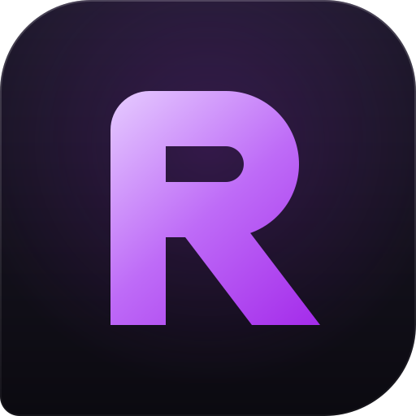
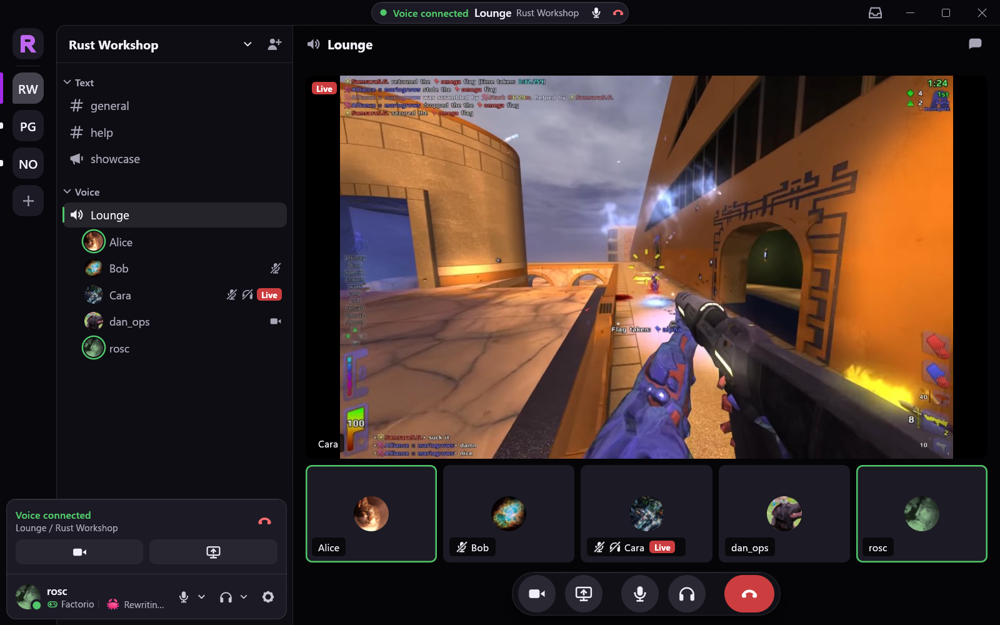
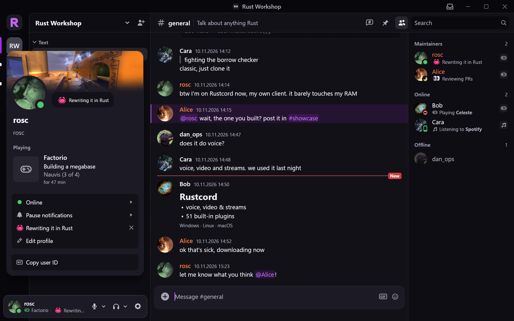

<p align="center">
  
</p>

<h1 align="center">Rustcord</h1>

<p align="center">
  Rustcord is an unofficial desktop client for Discord, written in Rust with egui and tokio.<br>
  It runs on Windows, Linux and macOS and talks to Discord's HTTP API and Gateway directly.
</p>

<p align="center">
  <a href="https://getrustcord.netlify.app/">Website</a> ·
  <a href="#download">Download</a> ·
  <a href="https://github.com/r0sc/Rustcord/issues">Issues</a>
</p>

<p align="center">
  
  
  
  
  <a href="https://github.com/r0sc/Rustcord/releases/latest"></a>
  <a href="https://github.com/r0sc/Rustcord/releases"></a>
</p>

Rustcord is in beta. Almost all of the code was written with AI coding tools (Claude Code).
Many features have only been tested with offline demo data, not with a live account. The Linux
and macOS builds have had the least testing. Please report bugs as a
[GitHub issue](https://github.com/r0sc/Rustcord/issues).

> [!WARNING]
> Third-party clients that log in with a user account break Discord's Terms of Service and can
> get the account banned. Use Rustcord at your own risk. Rustcord does not automate anything and
> keeps to Discord's rate limits, but the risk remains. By default your activity shows "Playing Rustcord", so friends and Discord can see that
> you use a third-party client. Turn it off in Settings → Activity privacy. Rustcord is not
> affiliated with Discord.

<p align="center">
  
</p>

<p align="center">
  
</p>

<table>
  <tr>
    <td></td>
    <td></td>
  </tr>
  <tr>
    <td align="center">Profile popout with a local-only banner</td>
    <td align="center">Built-in plugins in Settings → Plugins</td>
  </tr>
  <tr>
    <td></td>
    <td></td>
  </tr>
  <tr>
    <td align="center">Media viewer</td>
    <td align="center">Lilac theme</td>
  </tr>
</table>

<sub>Offline demo data, signed in as rosc. The other people, servers and messages are made up.
Image credits are under <a href="#credits">Credits</a>, and <code>scripts/readme-shots.py</code>
retakes the screenshots.</sub>

## Features

### Chat and media

- Server list with folders and drag and drop, channel lists, DM list and member list.
- Message history that loads more while you scroll up.
- Markdown (bold, italic, underline, strike, code, code blocks, links, spoilers, quotes,
  headings, lists, timestamps), mentions, custom and Unicode emoji, image and GIF attachments,
  stickers, basic embeds and forwarded messages.
- Send, edit and delete your messages, reply with or without a ping, react, and forward a
  message to one channel.
- Polls: vote, remove your vote, see who voted and create one.
- File uploads by button, drag and drop or paste. Emoji and GIF pickers and `@ # :`
  autocomplete.
- Typing indicator, pins, search and mark unread.
- Threads: sidebar rows, the thread panel and creating threads.
- Forum and media channels with posts, tags and creating a post.
- Video uploads, video embeds and GIFV play inline. The player supports MP4 with H.264 and AAC.
- Images, GIFs and videos open in a viewer with zoom, pan, arrow keys, Save, Copy image and Copy
  link. The browser opens only from "Open in browser", for videos the player cannot play (WebM)
  and for YouTube or Twitch.
- Unread indicators, mention badges, a "new messages" bar, jump to present and a message
  context menu.
- Quick switcher (Ctrl+K) for servers, channels, DMs and friends, with the `@ # ! *` prefixes.
- Discord's navigation keys: Alt+↑/↓, Alt+Shift+↑/↓, Ctrl+Alt+↑/↓, Esc and Shift+Esc to mark
  read, and Ctrl+/. All keys can be changed under Settings → Keybinds.
- A disk cache of servers, channels, DMs, recent messages and images. Later starts show the
  cached UI at once and refresh it in the background.

### Servers and friends

- Friends (online, all, pending, blocked, add by username), DMs and group DMs.
- Message requests (accept, ignore, spam) and the inbox with mentions and unreads.
- Server administration: channels, categories, roles, permission overwrites, members, kick and
  ban, bans, invites, emoji and notification settings.
- Verified and partnered marks and the boost level show before the server name in the server
  bar tooltip and the server header ("Boost level 2, 9 boosts").

### Voice and video

- Voice channels and calls with DAVE end-to-end encryption, camera, screen share (Go Live) and
  watching streams.
- Camera and screen are only captured after an explicit click. Camera and screen share are
  Windows only for now. On Linux and macOS you can still watch others.
- A call island in the title bar shows the current voice call with mute and disconnect.

### Profiles and activity

- User profiles with notes.
- Online status and custom status.
- Profile cosmetics from Discord: avatar decorations, nameplates, profile effects and frames,
  display-name styles, profile themes, clan tags, badges, connections and games. An uploaded
  banner fades into the profile's background color.
- Clicking a badge shows what it means instead of opening a link, with its date when Discord
  gives one ("Subscriber since …").
- Clicking a server tag opens that server's card with Go to server, Join server or Apply to
  join.
- A local profile banner and avatar in Settings → Local profile. The banner can be any image or
  GIF, the avatar a GIF, APNG, animated WebP or still image. They replace your banner and avatar
  everywhere in this client and are only visible to you on this device. "Only on hover"
  animation keeps idle CPU at zero, and each override has its own *Reset* button.
- A cosmetics editor with Discord's shop catalog. Items you own go on your account only
  through "Apply to account". Without full Nitro, your picks show only in this client and are
  not sent.
- Activities: games with their art, party size and elapsed time, Spotify with album art and a
  progress bar, streaming and watching. They show in the member list, DMs, friends and profile
  cards.
- Your activity shows Rustcord by default, with the version and how long it has been open. A
  game you play shows first. Settings → Activity privacy has the switch and a preview.
- An optional Application ID in Settings → Activity privacy: the icon of an app you create in
  the Discord Developer Portal becomes the activity's picture.
- Game detection every 15 s, against Discord's list of detectable games and the games you add
  in Settings → Registered games. "Add it!" picks an open window. On Linux it also finds Wine
  and Proton games, on macOS app bundles.
- Detected games show their icon, or a controller when there is none. Others only see your
  game while "Share detected activity" in Settings → Activity privacy is on. That switch is
  synced with your account, as in the official app. Your added games stay on this PC.
- Discord Quests: a Quests row under Friends lists your quests, their rewards and your Orbs.
  Accept and claim each one with a click.
- Video quests only count while the video plays in Rustcord's player in a visible window. Discord
  counts play and stream quests only from its desktop app, so they have to be finished there.

### Account and settings

- Log in by QR code, with an email or phone number and password (with 2FA), or with a pasted
  token. The session token is kept in the OS credential store, and logging out clears it (see
  [Logging in](#logging-in)).
- User settings follow Discord's pages and order and can be searched. The pages include My
  Account, Profiles, Content & Social, Data & Privacy, Devices, Authorized Apps, Connections,
  Friend Requests, Appearance, Accessibility, Voice & Video, Chat, Notifications, Keybinds,
  Language, Streamer Mode, Advanced, Activity Privacy and more.
- Synced options are written to your account's settings. Options whose effect could not be
  confirmed are left out. Log Out and other destructive actions ask first.
- My Account security: email and phone, Change Password, SMS backup, View/Generate Backup Codes
  and Account Standing.
- Authenticator app setup (QR code and key, then backup codes) and removal. Security keys can be
  renamed and removed.
- The 2FA re-check that Discord asks for is supported. Disable and Delete Account only open
  discord.com.
- Passwords and codes are wiped from memory when their dialog closes. A rotated login token
  replaces the stored one.
- Themes in TOML with a live editor, three built-in themes, and import and export (see
  [Themes](#themes)).
- Gradient app themes (the Nitro color themes), free and only on this device.
- Settings open as a floating panel over the app.
- A custom title bar with window buttons, and a floating user panel.
- Channel icons keep Discord's meanings (`#` for text, a speaker for voice, megaphone, forum,
  media, stage, rules), with lock and age-restricted variants. No icon files are copied from
  Discord.
- Discord's UI font (gg sans) is downloaded at runtime from discord.com into the cache folder
  and never bundled. Settings → Appearance turns it off.
- Without gg sans, Rustcord uses the system font: Segoe UI on Windows, Noto Sans or DejaVu Sans
  on Linux, Arial on macOS.
- Decorated channel and role names (`・〢┊꒰ᘏ`, 𝐛𝐨𝐥𝐝 letters, box drawing) use the system's
  fallback fonts instead of empty boxes.

### Desktop

- A tray icon (notification area on Windows, system tray on Linux, menu bar on macOS), close to
  tray and open at login.
- An installer for each system, and automatic updates (see [Install](#install) and
  [Updates](#updates)).
- Desktop notifications for mentions and DMs, also while minimized. They use Windows
  notifications, freedesktop notifications on Linux and Notification Center on macOS.
- App sounds for messages, mentions, calls, voice join and leave, mute, deafen, push to talk and
  streams. Each sound can be turned off, and one volume setting covers all of them.
- Keyword alerts: your words get a notification and the mention highlight, even in muted
  channels.
- Quiet hours, with a pause from the tray or the account menu. Keyword alerts and quiet hours
  stay on this device.
- Game overlay on Windows (Settings → Game overlay). While a detected game is in front, two
  small click-through windows show who is talking in your voice channel and notification cards.
  Nothing is injected into the game, and only borderless or windowed games are supported.
- Crash reports: after a panic, Rustcord saves a small text report in the config folder
  (`crash/`, the newest 5). It holds the version, the system, the panic's message and place,
  and which plugins were on.
- The next start shows the report in a card with Copy report, Report on GitHub and Dismiss. If
  the panic came from a plugin, the card offers to turn that plugin off. Nothing is sent.

### Plugins

- 51 plugins in Settings → Plugins, modeled on Vencord's. All of them are off by default and
  only change this app. Their options are stored in `plugins.toml`.

<details>
<summary>The 51 plugins</summary>

AccountPanelServerProfile, BetterFolders, BetterRoleDot, CallTimer, CharacterCounter,
ClearURLs, ClientDiagnostics (frame, memory and connection numbers in Settings → Advanced),
CopyUserURLs, CustomIdle, FavoriteEmojiFirst, FriendsSince, GameActivityToggle, ImageZoom,
IrcColors, MemberCount, MessageLinkEmbeds, MessageLogger (memory only), MoreUserTags,
MutualGroupDMs, NoBlockedMessages, NoReplyMention, NotificationLog (a Recent tab in the Inbox,
with the silenced ones), OnePingPerDM, OpenInApp, PermissionsViewer, PinDMs, PlatformIndicators,
QuickReply (Ctrl+Up and Ctrl+Down to reply, with Shift to edit your own),
ReadAllNotificationsButton, RelationshipNotifier, ReplyTimestamp, ReverseImageSearch, ServerInfo, ShowConnections,
ShowHiddenChannels, ShowMeYourName, ShowTimeoutDuration, SilentMessageToggle, SilentTyping,
TextReplace, Translate, TypingIndicator, TypingTweaks, UserVoiceShow, ValidUser, VcNarrator
(Windows speech, `say` on macOS, `spd-say` on Linux), ViewIcons, ViewRaw, VoiceMessages
(playback), VolumeBooster (up to 400 %, local mix only), WhoReacted.

</details>

Not included: other Nitro features, account creation, a sticker picker, slash commands and bot
components, and completing quests automatically.

## Download

The [website](https://getrustcord.netlify.app/) offers the file for your system. All files are
also on the [latest release](https://github.com/r0sc/Rustcord/releases/latest) page. `<version>`
is the release's version, for example `0.1.5`.

| System | File |
|---|---|
| [Windows, 64-bit](https://github.com/r0sc/Rustcord/releases/latest) | `Rustcord-Setup-<version>.exe` |
| [Debian, Ubuntu, Mint and relatives, 64-bit x86](https://github.com/r0sc/Rustcord/releases/latest) | `rustcord_<version>_amd64.deb` |
| [Any Linux, 64-bit x86, glibc 2.35+](https://github.com/r0sc/Rustcord/releases/latest) | `rustcord-<version>-linux-x86_64.tar.gz` |
| [macOS 11+, Apple silicon and Intel](https://github.com/r0sc/Rustcord/releases/latest) | `Rustcord-<version>-macos-universal.dmg` |

The release also holds the macOS update package `.app.tar.gz`, the signed update feed
`latest.json` with `latest.json.sig`, and `SHA256SUMS` for
[verifying downloads](#verifying-downloads).

The Windows setup is not code-signed and the macOS app is not notarized, so the first start
needs one extra step (see [Install](#install)). To build from source, see [Build](#build).

## Install

### Windows

`Rustcord-Setup-<version>.exe` is a single exe of about 23 MB with the app inside, built from
`src/bin/rustcord-setup`. It installs for your Windows user only and needs no administrator
rights.

The app goes to `%LOCALAPPDATA%\Programs\Rustcord`, with a Start menu shortcut, an optional
desktop shortcut and an entry in Settings → Apps. "Open Rustcord when I sign in to Windows" is
on by default and starts Rustcord hidden in the notification area. Running a newer setup by hand
updates Rustcord in place, after asking a running Rustcord to quit. `--silent` installs with the
default options and no window.

The setup is not code-signed, so SmartScreen may show "Windows protected your PC". Select
**More info**, then **Run anyway**.

Click the icon in the notification area to open the window. Right-click it for Open Rustcord,
Mute, Deafen and Quit Rustcord. Closing the window (the × in the title bar) only hides it, so
notifications and voice keep working. Settings → Windows settings has "Minimize to tray when I
close the window" (turn it off to quit on close), "Open Rustcord when I sign in to Windows" and
"Start minimized". Starting Rustcord again brings the running window to the front.
`rustcord.exe --quit` quits the running one.

To uninstall, use Settings → Apps → Rustcord → Uninstall. "Also delete my local data and sign
out" also removes the settings, the cache and the saved login.

To build the setup yourself (Windows, see [Build](#build)):

```powershell
powershell -ExecutionPolicy Bypass -File scripts\build-installer.ps1   # -> dist\Rustcord-Setup-<version>.exe
```

### Linux

Two packages for 64-bit x86 with glibc 2.35 or newer (Ubuntu 22.04+, Debian 12+, Fedora 36+):

- `rustcord_<version>_amd64.deb` for Debian, Ubuntu, Mint and their relatives:
  `sudo apt install ./rustcord_<version>_amd64.deb`. `sudo apt remove rustcord` removes it.
- `rustcord-<version>-linux-x86_64.tar.gz` for any distribution, installed for your user only
  (no root):

  ```bash
  tar -xzf rustcord-<version>-linux-x86_64.tar.gz
  sh rustcord-<version>/install.sh                     # add --no-autostart to skip the login start
  sh ~/.local/share/rustcord/install.sh --uninstall    # later; --purge also deletes settings, cache and login
  ```

  It puts the app in `~/.local/bin/rustcord`, its app menu entry and icons in
  `~/.local/share`, and the login start in `~/.config/autostart/rustcord.desktop`. Running a
  newer `install.sh` by hand updates Rustcord in place and keeps your login start choice. A
  running Rustcord is asked to quit first. The tarball uses the system's libraries: ALSA,
  OpenSSL 3, OpenGL, X11 and libxkbcommon-x11. `install.sh` says when libxkbcommon-x11 is
  missing.

"Open Rustcord when I log in" is on by default. Rustcord turns it on at its first start, and
Settings → Linux settings turns it off. It starts Rustcord hidden in the system tray.

Wayland does not let an app hide its window to a tray, so Rustcord runs on X11, and through
XWayland on Wayland desktops, as Discord's app does. The tray icon needs a desktop with a
StatusNotifierItem tray, such as KDE, Xfce, Cinnamon or Ubuntu's GNOME. Plain GNOME (Fedora)
needs the AppIndicator extension, otherwise closing the window quits Rustcord. The login is kept
in the Secret Service keyring (GNOME Keyring or KWallet). Without one, Rustcord cannot remember
it.

Turn off "Open Rustcord when I log in" before `apt remove rustcord`. The login start belongs to
your user and stays behind, though it does nothing once the app is gone.

### macOS

`Rustcord-<version>-macos-universal.dmg` runs on Apple silicon and Intel Macs with macOS 11
or newer. Open it and drag Rustcord onto Applications.

The app is not notarized by Apple, since notarization needs a paid Apple developer account.
macOS therefore blocks the first start ("Apple could not verify…"). Open Rustcord once, then go to System Settings →
Privacy & Security and click **Open Anyway** next to the Rustcord message. Since macOS 15,
right-click → Open no longer skips the check. On macOS 14 and older, right-click Rustcord in
Applications → **Open** → **Open** also works. In Terminal,
`xattr -dr com.apple.quarantine /Applications/Rustcord.app` does the same.

The app is only ad-hoc signed, so macOS may ask again for the microphone and the keychain (the
saved login) after each update.

Closing the window keeps Rustcord in the menu bar. Quit it from the menu bar icon or with
Cmd+Q. "Open Rustcord when I log in" is on by default. It adds a login item in
`~/Library/LaunchAgents/io.github.r0sc.rustcord.plist`, and macOS shows a notice when it is
added. To uninstall, turn that off in Settings → macOS settings, quit Rustcord and move it from
Applications to the Trash.

### Updates

Installed copies update themselves from this repository's releases.

- Rustcord checks for a new version when it starts and every 6 hours while it runs, also while
  it waits in the tray. The start never waits for the network.
- A new version found right after the start, before you click or type, is installed at once
  behind an update screen, and Rustcord restarts into it. Otherwise it downloads in the
  background and **Update ready** appears in the title bar. Click it to restart now, or the next
  start installs it.
- Settings → Windows settings (Linux settings, macOS settings) → Updates shows the current version
  and has **Check for updates** and **Install updates automatically**, which is on by default. With
  it off, Rustcord still checks, but downloads and installs nothing until you click **Update
  available**. The automatic check itself has no switch.
- `.deb` installs download the new package. **Install** then runs `apt-get install` through
  `pkexec`, which asks for your password. Without `pkexec`, Rustcord shows where it saved the
  `.deb`.
- On macOS the app updates itself only where it may write: `/Applications` (as an
  administrator) or `~/Applications`.

After 10 minutes hidden in the tray, Rustcord installs a downloaded update and restarts hidden,
but not during a call or a screen share. On macOS it waits for the next start or a click
instead. A copied exe, a build from source or a copy started with `RUSTCORD_HOME` only shows
**Update available**, which opens the release page. Failed updates and the other details are in
[`docs/UPDATER_DESIGN.md`](docs/UPDATER_DESIGN.md).

Privacy: the check downloads `latest.json` and `latest.json.sig` from github.com, and a package
from GitHub's download servers when there is one. GitHub sees your IP address and the user agent
`Rustcord/<version>` every 6 hours. Nothing else is sent: no Discord token, cookie, header or
other personal data.

### Verifying downloads

Every release has `SHA256SUMS` with the SHA-256 of each file in it: compare with
`Get-FileHash Rustcord-Setup-<version>.exe` (PowerShell), `sha256sum -c SHA256SUMS
--ignore-missing` (Linux) or `shasum -a 256 <file>` (macOS).

The update feed `latest.json` names the newest version and, per system, the package's URL,
SHA-256 and size. It is signed with Ed25519 (`latest.json.sig`, base64); the public key is
[`assets/update-signing.pub`](assets/update-signing.pub), built into the app. Rustcord checks
the signature before it reads anything in the file, accepts only newer versions from this
repository's release downloads, and checks the size and SHA-256 before it uses a download. To
check the signature yourself with OpenSSL 3 (bash):

```bash
{ printf '\x30\x2a\x30\x05\x06\x03\x2b\x65\x70\x03\x21\x00'; base64 -d update-signing.pub; } > pub.der
base64 -d latest.json.sig > latest.json.sig.bin
openssl pkeyutl -verify -pubin -keyform DER -inkey pub.der -rawin -in latest.json -sigfile latest.json.sig.bin
```

## Logging in

The login screen has three tabs:

- QR code (the default): open the Discord mobile app → Settings → Scan QR Code, scan the code
  and confirm on the phone. Each code lives about two minutes. After that, click *New code*;
  Rustcord never retries on its own.
- Email: an e-mail address or phone number (`+49…`) and the password. If the account uses
  two-factor authentication, Rustcord then asks for a code from the authenticator app, an SMS
  code (*Send SMS* first) or one of the backup codes.
- Token: paste an account token. The tab explains where to find it.

Discord asks for a captcha for logins it finds unusual and after many sign-in attempts. On
Windows and macOS, Rustcord then shows Discord's hCaptcha in the sign-in card, under the
password or 2FA code field. After you solve it, Rustcord sends the same login again with the
result, and *Cancel* ends the attempt. A picture challenge covers the window until you finish it
or click beside it. The captcha only talks to hCaptcha, never to Discord, and its temporary
profile is deleted afterwards. `docs/AUTH_NOTES.md` has the details and the origin it runs
under.

Limits:

- Rustcord never solves or bypasses a captcha. It shows Discord's captcha and passes your answer
  on, and Discord can still refuse an answer given in Rustcord. The QR code and token tabs do not
  depend on the captcha.
- On Linux, and on Windows without the WebView2 runtime, Rustcord cannot show the captcha. It
  says so, and more attempts do not help. Wait a while, use the token tab, or sign in once in the
  official app.
- Accounts whose only 2FA method is a security key or passkey, and Discord's "new login
  location" checks (e-mail link or SMS), need the QR code or one login in the official app.
- Every login attempt is one click. Rate limits are shown ("Wait N s") and never retried
  automatically.

What is stored: only the resulting session token, and only with *Remember on this device*
checked (in the OS credential store, see [Files and settings](#files-and-settings)). The password
and 2FA code are never written to disk or logs and are not shown in error messages. Rustcord
wipes its own copies from memory after sending them. The QR login uses a new RSA key per code
that only lives in memory.

## Build

Requirements:

- Rust stable, 1.95 or newer.
- Windows: the MSVC build tools (Visual Studio Build Tools with "Desktop development with C++").
- Linux: a C and C++ compiler, `pkg-config` and the ALSA and OpenSSL development packages. On
  Debian and Ubuntu: `sudo apt install build-essential pkg-config libasound2-dev libssl-dev`.
- macOS: the Xcode command line tools (`xcode-select --install`).

```bash
cargo build --release
```

The binary is `target/release/rustcord` (`rustcord.exe` on Windows, which embeds
`assets/rustcord.ico` via `build.rs`). Run the tests with:

```bash
cargo test
```

If the project lives in a very deep folder, the MSVC linker can fail with `LNK1104` because
of the 260-character path limit. Build into a short target directory instead:

```powershell
$env:CARGO_TARGET_DIR = 'C:\rc-target'; cargo build --release   # PowerShell
```

```bash
CARGO_TARGET_DIR='C:/rc-target' cargo build --release            # Git Bash
```

The binary is then at `C:\rc-target\release\rustcord.exe`.

The Linux and macOS packages:

```bash
bash scripts/build-linux.sh   # on Linux (needs dpkg-deb): dist/rustcord_<version>_amd64.deb and dist/rustcord-<version>-linux-x86_64.tar.gz
bash scripts/build-macos.sh   # on a Mac: dist/Rustcord-<version>-macos-universal.dmg and .app.tar.gz (both architectures, ad-hoc signed)
```

`.github/workflows/release.yml` builds all three systems on GitHub. It never runs on pushes or
pull requests. Start it under Actions → release → Run workflow to get the packages as workflow
artifacts; "check_only" runs only fmt, clippy and the tests. Pushing a tag `v<version>` that
matches the version in `Cargo.toml` also creates a draft release with the packages, the signed
update feed and `SHA256SUMS`, to publish by hand (see [Releasing](#releasing)).

The app icons are made from `assets/logo.svg` and `assets/logo-small.svg`. `logo-small.svg` is
the same R-bubble, drawn larger, for sizes up to 32 px. `assets/logo-mono.svg` is the flat
one-color mark without the tile, and `logo_mark` in `src/ui/sidebar.rs` paints the in-app vector
copy. After editing the SVGs, regenerate the icons with this command, which uses the dev-only
dependency `resvg`:

```bash
cargo run --example export_icons
```

## Files and settings

| What | Windows | Linux | macOS |
|---|---|---|---|
| Config (`settings.toml`) | `%APPDATA%\Rustcord\config\` | `~/.config/rustcord/` | `~/Library/Application Support/Rustcord/` |
| Themes (`*.toml`) | `…\config\themes\` | `…/themes/` | `…/themes/` |
| Local profile overrides | `…\config\overrides\` (`overrides.toml` and image copies) | `…/overrides/` | `…/overrides/` |
| Cache (snapshot, images) | `%LOCALAPPDATA%\Rustcord\cache\` | `~/.cache/rustcord/` | `~/Library/Caches/Rustcord/` |
| Updates (downloads, `state.toml`) | `%LOCALAPPDATA%\Rustcord\cache\update\` | `~/.cache/rustcord/update/` | `~/Library/Caches/Rustcord/update/` |
| Discord's device cookies and the logged-out fingerprint (`device.json`, kept across restarts and logouts; owner-only on Linux and macOS) | `…\config\device.json` | `…/device.json` | `…/device.json` |
| Login token | Windows Credential Manager (generic credential `user-token.Rustcord`) | Secret Service | Keychain |
| Added games, saved games list | `…\config\games.json`, `…\cache\detectable.tsv` | `…/games.json`, `~/.cache/rustcord/detectable.tsv` | `…/games.json`, `~/Library/Caches/Rustcord/detectable.tsv` |
| Installed app (setup) | `%LOCALAPPDATA%\Programs\Rustcord\` | `/usr/bin/rustcord` (.deb), `~/.local/bin/rustcord` (install.sh) | `/Applications/Rustcord.app` |
| Start at sign-in | `HKCU\Software\Microsoft\Windows\CurrentVersion\Run`, value `Rustcord` | `~/.config/autostart/rustcord.desktop` | `~/Library/LaunchAgents/io.github.r0sc.rustcord.plist` |

The token is never written to a file or a log. Logging out deletes it from the credential
store and deletes the cache. `RUSTCORD_HOME=<dir>` moves config and cache to `<dir>/config`
and `<dir>/cache` (portable mode).

### settings.toml

Written by the settings page; all keys are optional.

```toml
theme = "Nightshade"          # built-in name or the name of a theme in the themes folder
desktop_notifications = true
send_read_acks = true         # mark viewed channels read on your account (syncs other devices)
show_member_list = true
animate_others = "hover"      # "always" or "hover": animated avatars and emoji of others
minimize_to_tray = true       # × hides the window to the notification area (Quit is in the tray menu)
auto_update = true            # install updates automatically (the check runs either way)
# [sounds]                    # Notifications > Sounds
# enabled = true
# volume = 70                 # percent, 0-100
# off = ["mention"]           # sounds switched off (message, mention, incoming_ring, join, ...)
# [keyword_alerts]            # Notifications > Keyword alerts
# everywhere = true           # false: only `places` (server or channel ids)
# places = ["123"]
# [[keyword_alerts.keywords]]
# text = "release"
# whole_word = true
# [quiet_hours]               # Notifications > Quiet hours
# enabled = false
# days = 127                  # bit 0 Monday .. bit 6 Sunday
# start = 1320                # minutes after midnight (22:00)
# end = 420                   # 07:00
# paused_until = 1800000000   # set by the tray / account menu pause (Unix seconds)
# client_build_number = 0     # optional: sent in the client properties
# system_locale = "en-US"
```

### Themes

Rustcord has three built-in themes: **Nightshade** (the default), **Lilac** and **High
Contrast**. Create your own in Settings → Appearance (live preview, *Save as…*, *Import…*,
*Export…*) or put a file into the themes folder:

```toml
name = "Forest Night"
dark = true

[colors]
background = "#16201b"        # message area
sidebar = "#111915"           # channel / DM list
guild_bar = "#0b110e"         # server icon column
surface = "#1f2b25"           # inputs, embeds, popups
text = "#e3efe7"
text_muted = "#93a89b"
accent = "#5fbf7a"
accent_text = "#08140c"       # text drawn on the accent color
message_hover = "#1b2620"
mention_highlight = "#23402c"
link = "#8fd0ff"
danger = "#ef6b5f"
code_background = "#0f1612"

[font]
ui_font = 'C:\Windows\Fonts\georgia.ttf'   # empty = built-in
mono_font = 'C:\Windows\Fonts\consola.ttf' # empty = built-in
size = 17.0

[layout]
corner_radius = 12.0
compact = false               # true = compact rows without avatars
```

Colors are `#rrggbb` or `#rrggbbaa`. Font paths must be local files. The old built-in theme
names Ember Dark and Paper Light still load, as Nightshade and Lilac.

## Performance

| Window visible (GL context ready) | First frame (cached UI) | RAM (working set) | Idle CPU |
|---|---|---|---|
| 183 ms | 199 ms | 96.0 MB (87.0 MB private) | 0 % |

Measured with a release build on a Ryzen 7 5825U with Windows 11, median of 5 runs, offline with
cached data for 3 servers and DMs. No network images were loaded. With a live connection,
avatars and attachments add to RAM; textures are capped at a 12 MB budget and evicted when
unused.

## Development

The Gateway client handles heartbeats, zombie detection, resume, reconnect backoff and
zlib-stream compression. REST requests follow the per-bucket and global rate limits and honor
`retry_after`.

- `docs/ARCHITECTURE.md`: module layout (`gateway/`, `api/`, `cache/`, `ui/`, `theme/`,
  `assets/`), data flow, rules and test hooks (`RUSTCORD_OFFLINE`, `RUSTCORD_SCREENSHOT`, …).
- `docs/PROTOCOL_NOTES.md`: the user-API protocol details the client implements.
- `docs/AUTH_NOTES.md`: the password, 2FA and QR login (remote auth v2) protocol.
- `docs/EGUI_0_37_NOTES.md`: egui 0.37 API notes.
- `docs/FEATURES_NOTES.md`: endpoints and events for chat, social, account and server features.
- `docs/VOICE_NOTES.md`, `docs/VOICE_DESIGN.md`, `docs/VIDEO_DESIGN.md`: the voice and video
  protocol (including DAVE) and the `src/voice/` engine.
- `docs/CHAT_ESSENTIALS_DESIGN.md`, `docs/SOCIAL_DESIGN.md`, `docs/ACCOUNT_SERVER_DESIGN.md`,
  `docs/SOCIAL_UI_DESIGN.md`: backend contracts and UI hook-up per feature block.
- `docs/DESIGN.md`: the design spec for the UI.
- `docs/MEDIA_DESIGN.md`: the inline video player and the media viewer.
- `docs/QUESTS_NOTES.md`: quests, the video progress rule and why play and stream quests are not
  advanced.
- `docs/UPDATER_DESIGN.md`: the self-updater, with the feed, signature, install per system and
  test hooks.
- `docs/RELEASING.md`: the update signing key, key rotation and repository hardening.
- `scripts/readme-shots.py`: retakes the README screenshots from the offline fixture (Windows):
  `python -I scripts/readme-shots.py --exe <rustcord.exe> [--avatar <picture>]`.

### Releasing

1. Set `version` in `Cargo.toml` (plain `X.Y.Z`, higher than the last release), run
   `cargo build` so `Cargo.lock` follows (CI builds with `--locked`), and commit both.
2. Tag it with the same version and push the commit and the tag:
   `git tag v0.1.1 && git push origin main v0.1.1`.
3. The release workflow builds the three systems and writes `latest.json` with
   `scripts/make-update-manifest.py`. It signs the feed with the repository secret
   `RUSTCORD_UPDATE_SIGNING_KEY` and verifies the signature against `assets/update-signing.pub`;
   a missing or wrong key fails the run. Then it adds `SHA256SUMS` and creates a **draft**
   release.
4. Check the draft: the four packages from [Download](#download), the `.app.tar.gz`,
   `latest.json` (its `version` and the four URLs point at this tag), `latest.json.sig` and
   `SHA256SUMS`. Then publish it. Installed copies pick it up within 6 hours
   (`releases/latest` ignores drafts and prereleases, so only a published release counts).

Creating, rotating and replacing the signing key is described in
[`docs/RELEASING.md`](docs/RELEASING.md).

## Credits

- The plugins do what [Vencord](https://github.com/Vendicated/Vencord)'s plugins (GPL-3.0) do.
  They are re-implemented in Rust, and no Vencord code, keys or assets are included.
- The README screenshots use the files in `docs/screenshot-assets/` (read by
  `scripts/readme-shots.py`). These files keep their own licenses; the MIT license covers
  Rustcord itself.
  - The live stream, the shared picture and the profile banner show one frame of
    [Red Eclipse 1,5 Gameplay 1](https://commons.wikimedia.org/wiki/File:Red_Eclipse_1,5_Gameplay_1.webm)
    by Premitre, licensed [CC BY 3.0](https://creativecommons.org/licenses/by/3.0/), via
    Wikimedia Commons (a still frame, scaled).
  - Avatars from Wikimedia Commons, cropped and scaled. Alice:
    [Cat face in sunlight](https://commons.wikimedia.org/wiki/File:Cat_face_in_sunlight_%28Unsplash%29.jpg)
    by Alicja Koczaska (CC0). Bob: [Crab Nebula](https://commons.wikimedia.org/wiki/File:Crab_Nebula.jpg)
    by NASA, ESA, J. Hester and A. Loll (public domain). Cara:
    [Neon streets](https://commons.wikimedia.org/wiki/File:Neon_streets_%28Unsplash%29.jpg) by
    JINDONG H (CC0). dan_ops:
    [Portrait of a labrador retriever](https://commons.wikimedia.org/wiki/File:Portrait_of_a_labrador_retriever.jpg)
    by Dktue (CC0).
  - The avatar of the account rosc is not part of the repository.

## License

MIT, see [LICENSE](LICENSE).

The Rustcord logo (`assets/`) is original to this project and does not use Discord's logo,
wordmark or brand colors. Discord's UI font (gg sans) is not part of this repository; it is
only downloaded at runtime.
